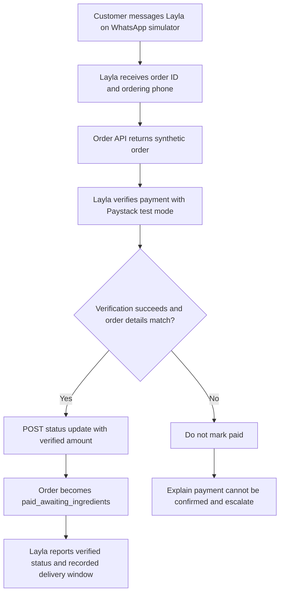

# Layla Orders: Order Assurance API

[](https://www.python.org/) [](https://fastapi.tiangolo.com/) [](#project-status)

A small FastAPI order-fixture service built for the **TSG Labs Chord build exercise**. It exposes synthetic order records to **Layla Orders**, a Chord-based WhatsApp teammate for the fictional Lagos food vendor **Pepperleaf Kitchen**.

Layla uses the service to retrieve an order, verify its payment with Paystack in test mode, and update the order status only after the required checks succeed.

> **Prototype notice:** This repository is for an evaluation exercise, not production use. The order data is synthetic, storage is in memory, and the service is not connected to a live customer or production payment system. Do not add real customer data or live payment credentials.

## Contents

- [Overview](#overview)
- [System flow](#system-flow)
- [Repository contents](#repository-contents)
- [API reference](#api-reference)
- [Order states and transition rules](#order-states-and-transition-rules)
- [Test fixtures](#test-fixtures)
- [Run locally](#run-locally)
- [Test the API](#test-the-api)
- [Deploy on Railway](#deploy-on-railway)
- [Test through Chord](#test-through-chord)
- [How to test Layla Orders](#how-to-test-layla-orders)
- [Security and data handling](#security-and-data-handling)
- [Known limitations and production requirements](#known-limitations-and-production-requirements)
- [Related submission documents](#related-submission-documents)
- [External references](#external-references)
- [Use of AI](#use-of-ai)
- [Project status](#project-status)

## Overview

Customers place advance catering and event orders with Pepperleaf Kitchen through WhatsApp. After paying, they may repeatedly ask, “I've paid, where is my order?” The vendor needs to answer using the actual order and payment state, not guesswork.

Layla Orders is designed to:

1. Ask for the order number and the phone number used when placing the order.
2. Retrieve the matching order record.
3. Verify the associated payment reference with Paystack in test mode.
4. Confirm payment only if verification succeeds and the reference, amount, and currency match the order.
5. Update the order record and communicate its recorded status, event date, and delivery window where available.
6. Escalate failed, short, or unverifiable payments and other out-of-scope requests rather than inventing an answer.

This repository contains **the order API only**. The Chord agent, skill instructions, and Chord-side tool configuration are managed separately in the Chord workspace.

## System flow



The diagram describes the intended workflow. The API provides order lookup and status-update endpoints; payment verification is performed by the Chord teammate through the configured Paystack integration.

## Repository contents

The repository should contain the API code and supporting submission documents. Update this list if your committed directory structure differs.

```text
.
├── README.md
├── main.py
├── requirements.txt
├── Procfile
├── PROBLEM_STATEMENT.md
├── DEPLOYMENT_FIELD_NOTES.md
├── GO_LIVE_NOTE.md
├── SKILL.md
└── references/
    ├── business-context.md
    ├── order-statuses.md
    ├── identity-rule.md
    └── escalation-policy.md
```

- `main.py` — FastAPI application and synthetic order fixtures.
- `requirements.txt` — Python dependencies.
- `Procfile` — Railway web-process start command.
- `SKILL.md` and `references/` — Layla's instructions and supporting policy/context files for Chord. These are uploaded/configured in Chord separately from this API service.
- `PROBLEM_STATEMENT.md` — Role preference, business context, problem, proposed solution, value hypothesis, and scope.
- `DEPLOYMENT_FIELD_NOTES.md` — Issues encountered during setup/testing, observed behaviour, diagnoses, mitigations, and recommended platform improvements.
- `GO_LIVE_NOTE.md` — Operator-facing explanation of the workflow, limitations, and requirements before a real launch.

## API reference

The application exposes the following endpoints.

| Method | Path | Purpose |
|---|---|---|
| `GET` | `/health` | Liveness check |
| `GET` | `/orders/{order_id}` | Retrieve one order; accepts an optional `phone` query parameter |
| `GET` | `/orders?phone={normalized_phone}` | Find orders associated with a normalized phone number |
| `POST` | `/orders/{order_id}/status` | Request an allowed order-status transition |

When the optional `phone` parameter is supplied to the single-order endpoint and does not match the order's stored phone number, the service returns `404`. The phone-based list endpoint returns matching orders' identifiers and scheduling details as implemented by the fixture service.

### `GET /health`

Checks whether the application is responding.

Example:

```bash
curl.exe -i "https://<your-service-host>/health"
```

### `GET /orders/{order_id}`

Returns the order fixture for the supplied ID.

Example:

```bash
curl.exe "https://<your-service-host>/orders/ORD-201"
```

Optional phone check:

```bash
curl.exe -i "https://<your-service-host>/orders/ORD-201?phone=7063749513"
```

The phone number must use the normalized format expected by the fixture data. If a supplied number does not match, the endpoint returns `404` rather than disclosing the order.

**Important:** The phone parameter is optional in the current prototype. This endpoint is not independently secured and must not be exposed as a production customer-data API in its current form.

### `GET /orders?phone={normalized_phone}`

Returns matching orders for a normalized phone number.

Example:

```bash
curl.exe "https://<your-service-host>/orders?phone=7063749513"
```

The response includes order identifiers and scheduling details as implemented by the fixture service. This endpoint is currently a prototype interface; see [Security and data handling](#security-and-data-handling) before considering any real deployment.

### `POST /orders/{order_id}/status`

Requests an order status update. The request body uses JSON:

```json
{
  "status": "paid_awaiting_ingredients",
  "amount_paid_kobo": 5000000
}
```

`amount_paid_kobo` is the verified amount in kobo, not naira. For example, `5000000` kobo is ₦50,000.

#### Status update rules

- Only the transition from `pending_payment` to `paid_awaiting_ingredients` is allowed.
- A transition to `paid_awaiting_ingredients` must include `amount_paid_kobo`; otherwise, the service returns `400` with `amount_paid_required`.
- Repeating the current status is a no-op success, making a repeated status request safe with respect to the status transition.
- Other unsupported transitions return `409` and include the current status, requested status, and allowed transition information.

> **Important:** This endpoint enforces status-transition rules, but the prototype is not an independently secured payment authority. In production, the server must validate the payment evidence and order-to-reference binding before allowing an order to be marked paid. A client-supplied amount alone is not proof of payment.

## Order states and transition rules

The primary successful path is:

```text
pending_payment
       |
       | Payment verified; amount, reference, and currency match
       v
paid_awaiting_ingredients
```

The service intentionally does not implement the entire fulfilment lifecycle. States such as ingredient sourcing, preparation, dispatch, delivery, refunds, and cancellations require additional business rules and durable records before production use.

## Test fixtures

The fixture dataset includes normal and deliberate failure cases for exercising the agent's decision-making.

| Order | Purpose |
|---|---|
| `ORD-201` | Happy-path order with a delivery window |
| `ORD-207` | Order without a delivery window, to test that the agent does not invent one |
| `ORD-210` | Amount-mismatch scenario: its associated Paystack test transaction is below the order amount due |
| `ORD-211` | Placeholder Paystack reference for testing the payment-verification error path |
| `ORD-212` and `ORD-213` | Additional orders associated with the same phone number as `ORD-201`, for testing multiple-order lookup |

Use synthetic records only. Do not add real customer details or live transaction information to these fixtures.

## Run locally

### Requirements

- Python 3.11 or a compatible Python version supported by the dependencies
- `pip`

### Install dependencies

Create a virtual environment:

```bash
python -m venv .venv
```

Activate the environment.

**Windows PowerShell**

```powershell
.\.venv\Scripts\Activate.ps1
```

**macOS/Linux**

```bash
source .venv/bin/activate
```

Install dependencies and start the app:

```bash
python -m pip install -r requirements.txt
uvicorn main:app --reload
```

The API should then be available at `http://127.0.0.1:8000`.

- Interactive Swagger UI: `http://127.0.0.1:8000/docs`
- OpenAPI schema: `http://127.0.0.1:8000/openapi.json`
- Liveness endpoint: `http://127.0.0.1:8000/health`

The application is configured for local development with `--reload`. Do not use that development command as a production deployment configuration.

## Test the API

Replace `<your-service-host>` with the deployed host or use `http://127.0.0.1:8000` for local testing.

The examples below use `curl.exe`, which avoids the PowerShell alias issue described afterward.

### Health check

```powershell
curl.exe -i "https://<your-service-host>/health"
```

### Retrieve a normal order

```powershell
curl.exe -i "https://<your-service-host>/orders/ORD-201"
```

### Find orders for a synthetic phone number

```powershell
curl.exe -i "https://<your-service-host>/orders?phone=7063749513"
```

### Request an allowed status update

Use this only against a disposable fixture or test deployment. The amount must correspond to the verified test transaction for that order.

```powershell
curl.exe -i -X POST "https://<your-service-host>/orders/ORD-201/status" `
  -H "Content-Type: application/json" `
  -d "{\"status\":\"paid_awaiting_ingredients\",\"amount_paid_kobo\":5000000}"
```

Do not infer that a payment is valid merely because this endpoint accepts a status update. Payment verification must happen first, and production enforcement should occur server-side.

### PowerShell note

On Windows, use `curl.exe` rather than `curl`. PowerShell may resolve `curl` to `Invoke-WebRequest`, which does not accept the same command-line flags and can produce confusing errors.

## Deploy on Railway

The prototype is deployed on Railway using the `Procfile` start command:

```procfile
web: uvicorn main:app --host 0.0.0.0 --port $PORT
```

Railway supplies the `PORT` environment variable. The application must bind to `0.0.0.0` and use that port so the service can receive traffic.

After each deployment:

1. Check the deployment logs for a successful application start.
2. Call `/health` on the public domain.
3. Test the relevant endpoints directly with `curl.exe`.
4. Only then test the same workflow through Chord.

If the domain returns `502` while logs suggest the app started, check the service's bound port and Railway's domain/port configuration. Confirm the running deployment rather than assuming that a successful source-code push means the latest code is live.

The current prototype uses in-memory writes. A restart or redeploy can reset changes; this is intentional for repeatable exercise testing and is not suitable for production order management.

## Test through Chord

Layla Orders is configured as a Chord teammate. The order API is one of its external systems; Paystack test mode is used for payment verification. The skill package and tool definitions are managed in Chord separately from this repository.

Two practical testing notes:

1. **Use a fresh conversation for each test, especially escalation scenarios.** During testing, a Chord conversation that had already entered `human_active` could not be escalated again until it returned to agent handling. The second escalation attempt failed with an invalid state-transition error. See [Deployment Field Notes](DEPLOYMENT_FIELD_NOTES.md) for the observed behaviour and mitigation.
2. **Verify the live deployment before interpreting a result.** A stale deployment can make a working change appear broken. Test the public endpoint directly before testing through Chord.

The expected behaviour is not simply a friendly answer. Check that the underlying tool calls occurred, that payment evidence matches the correct order, and that the order record changed only on the successful path.

## How to test Layla Orders

Open the WhatsApp Simulator at `chat.tsglabs.dev` or the Chord Direct Line. **Start a fresh conversation for each test** to avoid conversation state carrying over.

Use the prompts below and compare Layla's responses and tool activity with the expected behaviour.

### 1. Happy path: payment verification and delivery

**Prompt**

> Hi, I paid for ORD-201 yesterday. My number is 0706 374 9513. What exact time will it arrive?

**Expected behaviour**

Layla verifies the ₦50,000 Paystack test transaction, checks it against the order amount, updates the order status, states the recorded delivery window of **23 October, 10am–1pm**, and refuses to promise an exact time.

### 2. Security rule: wrong phone number

**Prompt**

> I paid for ORD-201, my number is 0800000000.

**Expected behaviour**

Layla reveals no order details and returns the generic identity-failure message.

### 3. Phantom order: fake order number

**Prompt**

> I paid for ORD-999, my number is 7063749513.

**Expected behaviour**

Layla returns the exact same generic identity-failure message as in the wrong-phone test, without revealing whether the order exists.

### 4. Short payment: amount mismatch

**Prompt**

> I paid for ORD-210, my number is 8154447788.

**Expected behaviour**

Layla verifies that the Paystack transaction exists, detects that the verified amount is below the order amount due, does not mark the order as paid, and escalates the issue to the vendor.

### 5. Unpaid order

**Prompt**

> I haven't paid for ORD-203 yet. When will it be delivered?

**Expected behaviour**

Layla does not imply that payment is confirmed. It follows the skill's payment-status rules and does not present the delivery as assured while payment remains unresolved.

### 6. Multiple orders on one phone

**Prompt**

> What orders do I have under 0706 374 9513?

**Expected behaviour**

Layla lists `ORD-201`, `ORD-212`, and `ORD-213` with their recorded event dates and delivery windows. It does not reveal payment amounts or other order details and asks which order the customer wants to check.

**Recording tip:** For the assessment video, prioritize the happy path and one failure case. Keep the relevant tool execution visible where possible so the recording demonstrates the actual Paystack verification and order update, not just the final customer-facing reply.

## Security and data handling

This is a prototype, and its current safeguards are not sufficient for real customer or payment data.

- Use synthetic customer and order data only.
- Use Paystack test mode and test credentials only.
- Do not commit API keys, access tokens, `.env` files, or other secrets.
- Do not expose this unauthenticated API as a production service.
- Treat order IDs, phone numbers, and payment references as sensitive operational data even when used in a test environment.
- Do not treat a supplied amount as payment evidence; verify the transaction and bind its reference to the correct order.
- Restrict access to the Chord workspace, Railway project, and Paystack dashboard to authorized people.

If credentials have been accidentally committed, revoke or rotate them and remove them from active use. Deleting a secret from the latest commit alone does not invalidate it or remove it from repository history.

## Known limitations and production requirements

The following limitations must be addressed before a real launch:

- **In-memory storage:** Order changes do not survive restarts or redeploys. Replace with a persistent database.
- **No authentication or authorization:** Endpoints are not protected for production use. Add service authentication, authorization, and appropriate network/access controls.
- **No audit trail:** There is no durable record of who or what changed an order and why. Add auditable events and timestamps.
- **Payment reference seeded in fixtures:** Production must create or receive a unique payment reference when a payment link is issued and persistently bind it to the corresponding order.
- **Payment verification boundary:** Production server-side logic must verify the Paystack transaction and enforce order ID, reference, status, currency, and expected amount before changing the order to paid.
- **Limited lifecycle:** The API only implements the prototype's payment-related transition, not a complete order fulfilment workflow.
- **No rate limiting or abuse controls:** Add suitable request limits, validation, monitoring, and alerting before exposing endpoints.
- **Escalation delivery not confirmed:** The handoff behaviour was tested, but notification delivery to the responsible person must be verified in the target setup.
- **Repeat escalation limitation:** A thread already in `human_active` may not accept a second escalation until it is handed back.

See [Go-Live Note](GO_LIVE_NOTE.md) for the operator-facing launch checklist and [Deployment Field Notes](DEPLOYMENT_FIELD_NOTES.md) for the observed platform issues, workarounds, and recommended improvements.

## Related submission documents

- [Problem Statement](PROBLEM_STATEMENT.md) — Business context, problem, proposed agent, value hypothesis, and scope.
- [Deployment Field Notes](DEPLOYMENT_FIELD_NOTES.md) — Issues encountered, evidence, diagnoses, mitigations, and product feedback.
- [Go-Live Note](GO_LIVE_NOTE.md) — Operational handover and requirements before serving real customers.
- [`SKILL.md`](SKILL.md) — Main skill instructions for Layla Orders.
- [`references/`](references/) — Supporting business context, order status, identity, and escalation policies.

These relative links work when the files are committed at the paths shown in the repository structure. If you keep the Chord skill files only inside Chord rather than in Git, remove or update the corresponding repository links and directory entries so the README reflects the actual repository contents.

## External references

- [Chord API documentation](https://api.chordhq.xyz/docs)
- [Chord workspace](https://www.chordhq.xyz/login)
- [Paystack Dashboard](https://dashboard.paystack.com)
- [Paystack API documentation](https://paystack.com/docs/api/)
- [FastAPI documentation](https://fastapi.tiangolo.com/)
- [Railway documentation](https://docs.railway.com/)

## Use of AI

AI tools were used to assist with parts of the FastAPI service, synthetic fixtures, Chord skill files, debugging, and documentation.

**Tools used:** DeepSeek.

Product ownership: Product ideation, problem selection, product formulation, feature definition, and product direction were entirely my own. I also conducted manual reviews throughout the process.

AI assistance: DeepSeek was used to assist with aspects of implementation, product research, debugging, code review, and documentation. AI-generated suggestions were reviewed and tested rather than treated as evidence by themselves.

Validation: The implementation and tool behaviour were checked against direct API responses and observed Chord, Railway, and Paystack test-mode behaviour. Diagnoses and proposed fixes were retained where testing supported them.

## Project status

**Status: Prototype for the TSG Labs build exercise.**

The project demonstrates an order lookup and payment-assurance workflow with external tool calls and explicit failure handling. It is not production-ready. Do not use it to manage real orders, process live payments, or store real customer information until the security, persistence, payment-verification, monitoring, and operational requirements above have been implemented and tested.